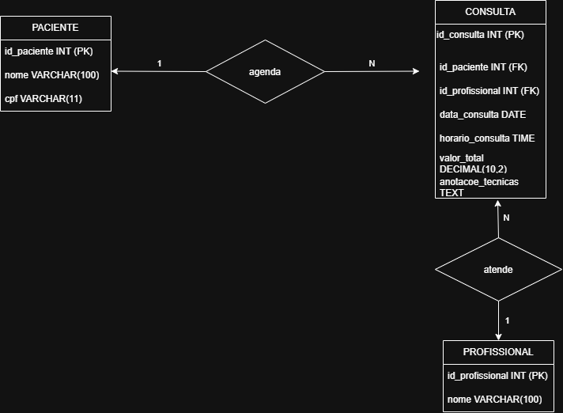

# Sistema da Clínica Odontológica Dr. Roberto

Este repositório apresenta o projeto desenvolvido para a clínica odontológica Dr. Roberto.

O sistema tem como finalidade facilitar o agendamento e a organização das consultas, permitindo cadastrar pacientes, armazenar informações sobre os atendimentos, escolher o dentista responsável e consultar os horários disponíveis.

## Diagrama do Banco de Dados (DER)

